# Awesome-Contract-Audit-Logging-Traceability 📑⚖️

  

  
  
  
  
  
  
  

---

## 🧭 Curated Directory: Top Contract Audit Logging & Traceability Ecosystem

> **A curated collection of enterprise SaaS platforms and battle-tested open-source projects providing immutable audit trails, cryptographic version history, tamper-evident ledgers, and defensible compliance evidence for contracts, electronic signatures, and legal obligations.**

In regulated industries and high-stakes commerce, contract lifecycle integrity requires verifiable proof of every agreement touchpoint—who authored, viewed, redlined, approved, signed, or exported a document. This guide catalogs platforms and frameworks that deliver defensible forensic audit records compliant with **SOX**, **HIPAA**, **eIDAS**, **SOC 2 Type II**, and **GDPR**.

---

## 📑 Table of Contents
- [📊 Sector Overview & Market Dynamics](#-sector-overview--market-dynamics)
- [☁️ SaaS / Hosted Platforms](#️-saas--hosted-platforms)
- [💻 Open-Source GitHub Projects](#-open-source-github-projects)
- [🛠️ Architectural Guidance & Stack Selection](#️-architectural-guidance--stack-selection)
- [🤝 How to Contribute](#-how-to-contribute)
- [💖 Support & Sponsorship](#-support--sponsorship)
- [📈 Star History](#-star-history)
- [⚖️ Disclaimer](#️-disclaimer)

---

## 📊 Sector Overview & Market Dynamics

The global Contract Lifecycle Management (CLM) and contract audit intelligence market is estimated at **$2.7B–$3.25B in 2025** and projected to reach **$3.67B in 2026**, expanding at a compound annual growth rate (CAGR) of **11.5%–14.2%**.

The sector exhibits **moderate fragmentation with increasing consolidation momentum**: while the top enterprise vendors (e.g., DocuSign, Icertis, Conga, Ironclad, and Agiloft) control roughly 28%–35% of total market revenue, over 150 specialized vendors operate globally across vertical compliance domains (healthcare, defense, financial services) and regional jurisdictions. However, rapid enterprise adoption of AI-native redlining, automated obligation extraction, and cryptographic audit proofs is driving M&A consolidation as leading platform incumbents acquire niche compliance and audit trail providers.

---

## ☁️ SaaS / Hosted Platforms

Below is a comparative breakdown of category-leading SaaS solutions offering native audit logging, e-signature traceability, or enterprise SIEM log retention for contract systems, sorted descending by company size (valuation / market capitalization / revenue).

| Product 🏢 | Market Size / Valuation 📈 | Starting Pricing 💳 | Free Tier / Trial Limits ⏱️ | Audit & Traceability Capabilities 🔍 |
|:---|:---|:---|:---|:---|
| **[Datadog Cloud SIEM](https://www.datadoghq.com/)** | ~$60B–$66B Market Cap (NASDAQ: DDOG) | $5.00 per million analyzed events / month (billed annually) | 14-day free trial; full Cloud SIEM features included up to standard ingestion quotas during trial. No permanent free tier. | Enterprise SIEM engine that ingests and correlates contract access logs, document downloads, and privilege escalations with out-of-the-box compliance detection rules and 15-month retention. |
| **[Splunk Enterprise](https://www.splunk.com/)** | ~$28B Acquisition Valuation (Cisco) | $0.00 (Splunk Free) / $150–$175 per GB indexed / month (Enterprise) | **Free Forever Plan**: 500 MB/day indexing capacity indefinitely, single-user access, no automated alerting. Enterprise trial: 60-day duration at 500 MB/day. | Centralized log ingestion, immutable index buckets, and tamper-evident audit reporting across multi-vendor contract repositories and CLM applications. |
| **[DocuSign CLM](https://www.docusign.com/)** | ~$14.5B–$15.5B Market Cap (NASDAQ: DOCU) | $1,000 per full user / year (~$83.33/user/month; typical mid-market minimum starting commit ~$15,000–$20,000/year) | 30-day free trial on standard DocuSign eSignature / IAM workflows. CLM enterprise audit trail requires a structured sales-assisted pilot. No permanent free tier. | Complete agreement execution history, timestamped participant activities, certificate of completion with cryptographic SHA-1/SHA-256 hashes, and granular workflow audit tracking. |
| **[AuditBoard](https://www.auditboard.com/)** | ~$3.0B Acquisition Valuation (Hg Capital) | $25,000 per year starting base contract (OpsAudit / CrossComply modules) | 14-day guided proof-of-concept / sandbox trial via enterprise sales demonstration. No self-serve or permanent free tier. | Connected risk and GRC platform mapping contract compliance controls directly to SOX, SOC 2, and ISO certifications with tamper-evident workpaper trails and reviewer sign-offs. |
| **[Ironclad](https://ironcladapp.com/)** | ~$3.2B Private Valuation ($200M+ ARR) | $15,000 per year starting deployment contract (entry-level core workflow bundle) | 14-day guided sandbox demo environment upon qualified sales consultation. No self-serve or permanent free tier. | Granular contract change audit logs tracking every line redline, condition approvals, metadata updates, and external participant views with SOC 2 Type II attestation. |
| **[Icertis](https://www.icertis.com/)** | ~$2.8B–$5.0B Private Valuation ($300M+ ARR) | $88,000 per year median contract starting threshold (enterprise licensing commitments) | Custom 30-day enterprise sandbox evaluation upon executive sponsor qualification. No permanent free tier. | Defensible enterprise CLM audit trail capturing all lifecycle events, contract modifications, approval chains, and Vera AI citations with cryptographic timestamping. |
| **[LogRhythm](https://www.logrhythm.com/)** | ~$2.5B Combined Entity Valuation (Exabeam / Thoma Bravo) | $27,000 one-time base software license (or $35,000 integrated hardware appliance) | 30-day full-featured software evaluation license with technical deployment guidance. No permanent free tier. | File integrity monitoring (FIM) and system log aggregation tracking unauthorized modifications to contract records, databases, and document vaults. |
| **[Agiloft](https://www.agiloft.com/)** | ~$500M+ Private Equity Valuation (KKR / FTV Capital) | $65.00 per user / month (billed annually; entry-level tier) | 30-day guided evaluation sandbox upon consultation with solutions engineering. No permanent free tier. | Highly configurable audit history tracking record additions, field-level differential updates, external viewer activity, and automated lifecycle event triggers. |
| **[CobbleStone Contract Insight](https://www.cobblestonesoftware.com/)** | ~$100M+ Private Valuation | $59.00 per user / month (Express Edition; billed annually) | 30-day free trial of Contract Insight Express with core repository and basic audit logging features enabled. No permanent free tier. | Dedicated History Log recording timestamped contract creation, metadata editing, approval checkpoints, and signature activities with exportable audit logs for compliance reviews. |

---

## 💻 Open-Source GitHub Projects

Explore these vetted open-source projects for self-hosted audit logging, document version control, digital signature verification, and tamper-evident cryptographic ledgers. Entries are sorted descending by GitHub Stars_Count.

| Project 📦 | GitHub_Stars ⭐ | Description 📝 | Primary Use Case 🎯 | License 📜 |
|:---|:---|:---|:---|:---|
| **[docuseal](https://github.com/docusealco/docuseal)** |  | Open-source platform for creating, signing, and processing digital contracts and PDF documents. Embeds cryptographic signatures, completion certificates, and timestamped audit logs for all signer actions. | Self-hosted DocuSign alternative & signed agreement audit trail | AGPL-3.0 |
| **[immudb](https://github.com/codenotary/immudb)** |  | Immutable zero-trust database with cryptographic proof of data integrity. Provides cryptographic verification, history of all state changes, and Merkle-tree tamper-evident ledgers for legal documents and audit events. | Cryptographic tamper-proof backend for contract state & audit events | Apache-2.0 |
| **[OpenSign](https://github.com/OpenSignLabs/OpenSign)** |  | Complete open-source document signing framework and PDF workflow engine. Generates tamper-evident audit trails with IP tracking, signer email verification, and cryptographic hash verification. | Electronic contract execution and legally binding audit logs | AGPL-3.0 |
| **[paper_trail](https://github.com/paper-trail-gem/paper_trail)** |  | Industry-standard Ruby ORM extension to track all changes to data models. Records every insert, update, and delete with user attributions, timestamps, and metadata diffs for audit compliance. | Application-level model audit logging and state re-creation | MIT |
| **[papermerge](https://github.com/ciur/papermerge)** |  | Open-source Document Management System (DMS) built for digital archives, scanned contracts, and compliance records. Features OCR text extraction, automated metadata tagging, and granular activity logging. | Contract archiving, versioning, and document access tracking | Apache-2.0 |
| **[OrgKernel](https://github.com/MetapriseAI/OrgKernel)** |  | Open-source trust layer featuring Ed25519 cryptographic agent identities, instance-scoped execution tokens, and SHA-256 hash-chained audit logging for autonomous transactions and contracts. | Cryptographic verification & hash-chained contract action logs | Apache-2.0 |
| **[django-auditlog](https://github.com/django-commons/django-auditlog)** |  | Lightweight Django app that tracks and stores object model changes. Logs field-level differentials, user IDs, and timestamps into relational database tables for defensible compliance trails. | Field-level differential logging for contract data models | MIT |
| **[openkm](https://github.com/openkm/document-management-system)** |  | Enterprise-grade open-source document management system featuring check-in/check-out version control, document differential inspection, retention policies, and complete access history. | Full contract lifecycle storage, versioning, and governance | GPL-2.0 |
| **[witness](https://github.com/in-toto/witness)** |  | Pluggable attestation and supply chain risk framework using the in-toto specification. Creates cryptographically verifiable audit trails with keyless signing via Sigstore and Open Policy Agent (OPA) enforcement. | Cryptographic attestation of digital artifacts and contracts | Apache-2.0 |
| **[aakd](https://github.com/aaked-app/aakd)** |  | Self-hostable contract operations workspace with page-level obligation extraction, approval audit records, user activity logs, and contract version history. | Contract operations workspace with obligation audit trails | AGPL-3.0 |
| **[clause-obligation-ledger-rs](https://github.com/mizcausevic-dev/clause-obligation-ledger-rs)** |  | High-performance Rust control plane for contract clause obligations utilizing append-only review event streams to generate compliance audit packets. | Append-only obligation review event ledgers | AGPL-3.0 |
| **[records-retention-system](https://github.com/dcatlin7921/records-retention-system)** |  | Offline-first web application for managing regulatory records retention schedules with comprehensive audit trail logging and JSON export capabilities. | Regulatory contract retention scheduling and action audits | MIT |

---

## 🛠️ Architectural Guidance & Stack Selection

When architecting a verifiable contract audit system, consider combining open-source building blocks:
- **Presentation & Signature Capture:** Deploy **[DocuSeal](https://github.com/docusealco/docuseal)** or **[OpenSign](https://github.com/OpenSignLabs/OpenSign)** for e-signature capture, signer attribution, and legal certificate generation.
- **Data Model Auditability:** Integrate **[paper_trail](https://github.com/paper-trail-gem/paper_trail)** (Ruby on Rails) or **[django-auditlog](https://github.com/django-commons/django-auditlog)** (Python/Django) for field-level diffs and state histories.
- **Immutable Log Storage:** Stream mission-critical contract lifecycle events into **[immudb](https://github.com/codenotary/immudb)** to prevent log tampering or post-facto ledger alteration.
- **Cryptographic Attestations:** Utilize **[witness](https://github.com/in-toto/witness)** to attach cryptographically verifiable signatures and attestations to executed contract documents.

---

## 🤝 How to Contribute

Contributions are warmly welcomed! Help keep this directory accurate, neutral, and comprehensive.

1. 🍴 **Fork** the repository.
2. 🌿 **Create a branch** for your updates (`git checkout -b feature/add-new-audit-tool`).
3. 📝 **Add or update** entries in `README.md` maintaining:
   - Specific pricing numbers (no generic "Custom" or "Usage-based" labels).
   - Concrete free tier / trial terms (no "None" or "N/A" placeholders).
   - Valid GitHub stargazers social badges linking to the repo stargazers page.
   - Alphabetical or star-sorted ordering where applicable.
4. 🔍 **Verify links** and formatting.
5. 🚀 **Submit a Pull Request** with a concise description of your changes.

---

## 💖 Support & Sponsorship

If you find this curated directory useful for your legal ops, security engineering, or compliance architecture work:

- ⭐ **Star this repository** to improve visibility for the open-source community!
- 🍴 **Fork and share** with colleagues in legal engineering, GRC, and DevOps.
- ☕ **Sponsor the Maintainer**: Support ongoing curation and open-source tooling on the [GitHub Sponsor Dashboard](https://github.com/sponsors/ishandutta2007).

Your support enables continuous updates and independent analysis of the contract compliance ecosystem!

---

## 📈 Star History

---

## ⚖️ Disclaimer

- This directory is a **community-curated educational resource** and does not constitute formal legal, regulatory, or technical advisory services.
- Always consult legal counsel and security compliance auditors when structuring contract retention, electronic signatures, and cryptographic audit logging under jurisdictions including SOX, eIDAS, HIPAA, and GDPR.
- Commercial SaaS pricing, terms, and trial durations reflect public procurement datasets and vendor websites as of 2026; consult vendors directly for official contractual quotes.

---

  <b>Built for Compliance Officers, Legal Engineers, Security Architects, and Open-Source Builders 🚀</b>

